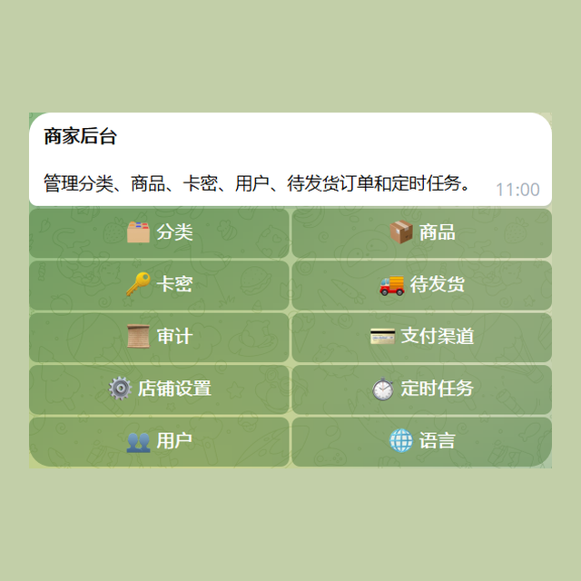
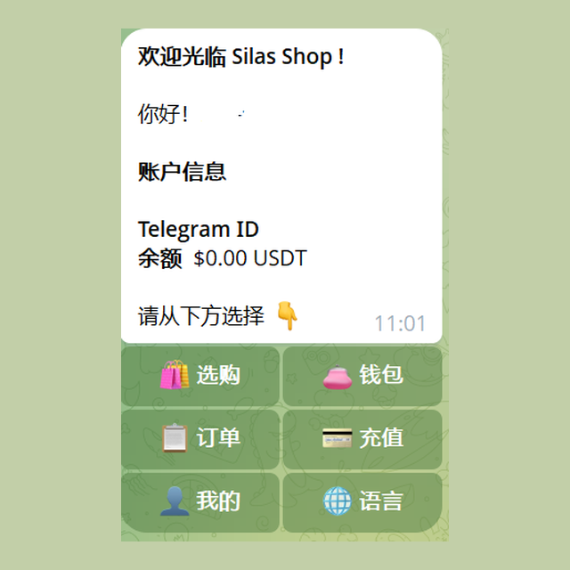

# Telegram Shop Bot

这是一个用 Telegram Bot 做的商店机器人。买家可以选购、下单、充值；商家可以管理分类、商品、卡密、发货和支付渠道。

[](https://www.python.org/)
[](https://core.telegram.org/bots/api)
[](https://www.sqlite.org/)
[](https://docs.docker.com/compose/)

[问题反馈](https://github.com/xiaocheny214/telegram-shop-bot/issues) · [贡献说明](CONTRIBUTING.md) · [许可证](LICENSE)

## 界面预览

<table>
<tr>
<td width="50%" align="center"><b>商家后台</b></td>
<td width="50%" align="center"><b>买家首页</b></td>
</tr>
<tr>
<td></td>
<td></td>
</tr>
</table>

## 功能特性

### 买家机器人

- [x] 浏览分类、商品和规格，下单购买
- [x] 钱包余额、充值，以及订单记录
- [x] 个人资料
- [x] 中文 / English 切换

### 商家机器人

- [x] 分类、商品和规格
- [x] 卡密导入，以及需要人工处理的待发货订单
- [x] 审计记录、店铺设置、定时任务、用户
- [x] 支付渠道
- [x] 只有 `ADMIN_TELEGRAM_IDS` 里的 Telegram 账号能进入

### 收款与运行

- [x] BEpusdt（USDT）已对接，可以收款
- [ ] 支付宝、微信支付、易支付已接入，尚未实测。见 [后续计划](#后续计划)
- [x] 支付回调地址由 `PUBLIC_BASE_URL` 生成
- [x] SQLite 单文件保存店铺数据
- [x] 定时关闭超时未支付的订单
- [x] `GET /health` 供 Docker 健康检查使用

## 后续计划

代码已经接进商家后台，下面这些还没做完。

### 支付渠道

- [ ] 实测易支付
- [ ] 实测支付宝
- [ ] 实测微信支付

### Web 端

- [ ] 卡网顾客页面：选购、充值、下单
- [ ] 商家管理页面：商品、卡密、订单

## 开始之前

| 准备 | 说明 |
| --- | --- |
| Python 3.12+ | 用 Docker 部署时，本机不必安装 Python |
| 两个机器人 | 在 [@BotFather](https://t.me/BotFather) 各建一个。两个令牌不能相同 |
| 商家 ID | 你的 Telegram 数字 ID。多个 ID 用英文逗号分开 |
| 支付私钥 | `PAYMENT_PRIVATE_KEY`，X25519 PKCS8 PEM。一行里用 `\n` 表示换行 |
| 公网 HTTPS | `PUBLIC_BASE_URL`。支付渠道靠它回调。只在本机试用、先不收款时可以留空 |

## 快速开始

- 只想把店跑起来：用下面的 Docker Compose。
- 要改代码：用本机虚拟环境，执行 `python -m shopbot`。

两种方式都要先有一份填好的 `.env`。变量说明见 [配置](#配置)。

## 安装部署

### Docker

先安装 [Docker Desktop](https://www.docker.com/products/docker-desktop/)。在仓库根目录：

```shell
copy .env.example .env
```

macOS 或 Linux 用 `cp .env.example .env`。填好 `.env` 之后：

```shell
docker compose up -d --build
```

容器监听 `0.0.0.0:8000`，数据库文件是容器内的 `/app/data/shop.db`，对应本机的 `./data`。确认进程：

```shell
curl http://127.0.0.1:8000/health
```

返回 `{"status":"ok"}` 即表示 HTTP 服务已起来。然后在 Telegram 里打开两个机器人。

### 源码

在仓库根目录：

Windows PowerShell：

```powershell
python -m venv .venv
.venv\Scripts\Activate.ps1
pip install -e .
copy .env.example .env
python -m shopbot
```

macOS 或 Linux：

```shell
python3 -m venv .venv
source .venv/bin/activate
pip install -e .
cp .env.example .env
python -m shopbot
```

启动前把 `.env` 填完整。默认监听 `127.0.0.1:8000`。开发依赖（含 pytest）在 `pyproject.toml` 的 `dependency-groups.dev` 里，跑店不必安装。

## 配置

复制 `.env.example` 为 `.env`。填了真实值的 `.env` 不要提交。

| 变量 | 必填 | 作用 |
| --- | --- | --- |
| `BOT_TOKEN` | 是 | 买家机器人令牌 |
| `MERCHANT_BOT_TOKEN` | 是 | 商家机器人令牌。不能和 `BOT_TOKEN` 相同 |
| `ADMIN_TELEGRAM_IDS` | 是 | 商家的 Telegram 数字 ID，多个用英文逗号分开 |
| `PAYMENT_PRIVATE_KEY` | 是 | X25519 私钥，PKCS8 PEM |
| `DATABASE_PATH` | 否 | SQLite 路径，默认 `data/shop.db`。Docker 里固定为 `/app/data/shop.db` |
| `HOST` | 否 | 本机默认 `127.0.0.1`。Docker Compose 会改成 `0.0.0.0` |
| `PORT` | 否 | 默认 `8000` |
| `PUBLIC_BASE_URL` | 收款时必填 | 本店公网根地址，例如 `https://shop.example.com`。必须是 `https`，末尾不要斜杠 |

支付渠道的商户参数在商家机器人的「支付渠道」里填写，不写进 `.env`。目前请配置 BEpusdt。易支付、支付宝、微信支付尚未实测。

## 常见问题

### 启动时提示缺少某个环境变量？

`.env` 不在启动时的工作目录，或对应项是空的。Docker 部署时，`.env` 放在含 `docker-compose.yml` 的目录。

### 启动时提示买家和商家机器人必须使用不同的令牌？

`BOT_TOKEN` 和 `MERCHANT_BOT_TOKEN` 填成了同一个。

### 顾客付了款，订单仍是未支付？

`PUBLIC_BASE_URL` 不是公网可访问的 `https` 地址，或支付平台的回调没有到达本机 `8000` 端口。

### 商家机器人里看不到管理菜单？

当前 Telegram 账号不在 `ADMIN_TELEGRAM_IDS` 中。ID 是数字，不是 `@用户名`。

## 反馈与贡献

问题用 [GitHub Issues](https://github.com/xiaocheny214/telegram-shop-bot/issues) 提交。参与改动前先看 [CONTRIBUTING.md](CONTRIBUTING.md)：每项改动从 Issue 开始，代码经 Pull Request 进入 `master`。

## 许可证

本仓库以 [PolyForm Noncommercial License 1.0.0](LICENSE) 发布。该许可证不允许把本软件用于商业目的。分发和修改也要遵守 `LICENSE` 里的条款。若需商用，请另行联系作者取得授权：Telegram [@silasvista](https://t.me/silasvista)。
